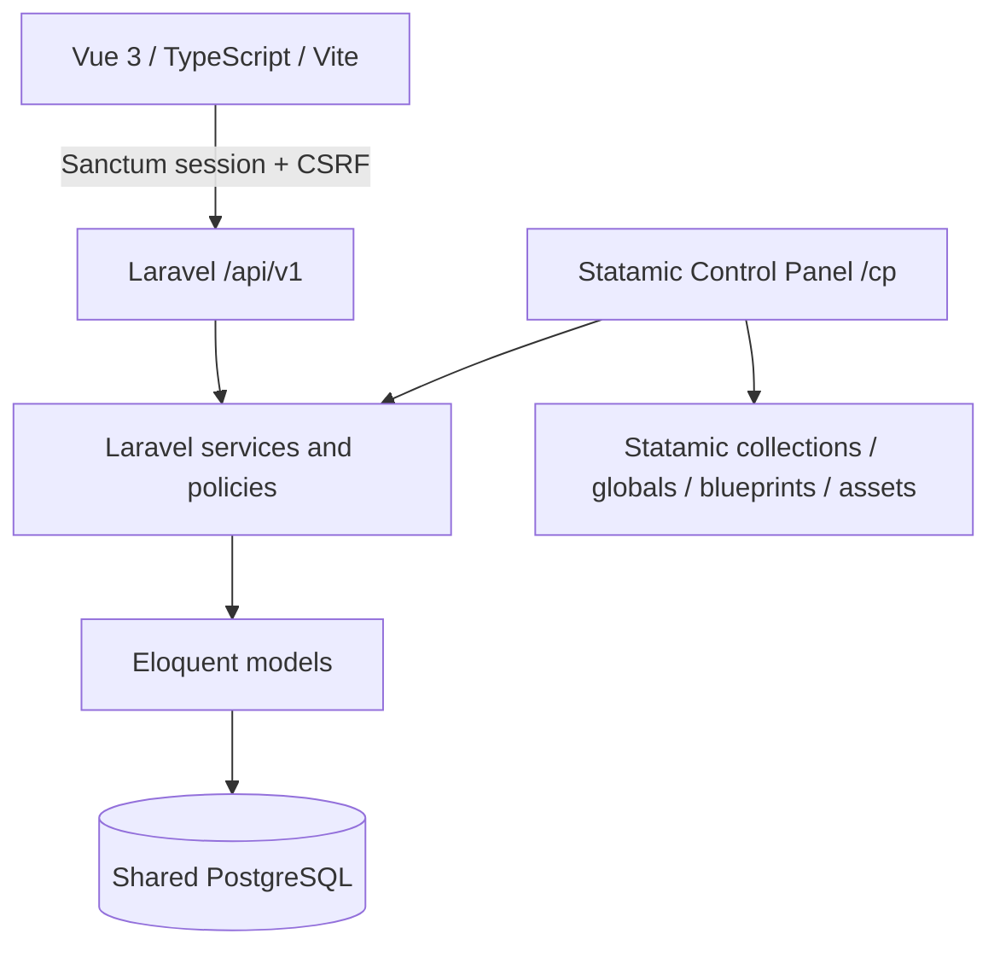

# Architecture

eRepair is a technician discovery platform with a supporting repair lifecycle. Subject 1 owns the customer/technician Vue 3 SPA and Laravel REST API. Subject 2 owns the Statamic Control Panel and native content authoring. Both use one Laravel application and one PostgreSQL database.

## Boundaries

- Vue owns routing, forms, accessible UI, and server-state rendering. Vue Router handles navigation; Pinia owns the authentication store; TanStack Vue Query caches server data in memory. Axios sends credentials and XSRF headers. SFCs use Composition API and script setup. Existing CSS, types, API transport and repair rules were retained.
- Laravel owns validation, discovery queries, matching, authorization, repair transitions, estimates, appointments, uploads and notifications. Thin controllers use Form Requests, services, policies and API Resources.
- Statamic is a Composer package in `backend/`, not a second Laravel application. Operational CRUD requires custom CP controllers/views or extensions backed by the same services. Statamic does not automatically administer Eloquent records.
- Marketplace identities live in `users` under Laravel's `web` guard. The single Statamic Core editor lives in `cms_users` under the independent `cp` guard, linked to the existing application administrator for operational audit records. Both tables use the same PostgreSQL database. Customers and technicians are not CMS identities; native user counting is unchanged. Login slots are separate, while session invalidation can log out both guards in the same browser.
- Native CMS content initially uses versionable Statamic files. These are editorial content, not a second application database. All identities, repair records, reviews, notifications and logs live in PostgreSQL. A future requirement for SQL-backed editorial content can use Statamic's Eloquent content driver against this same database.

## Deployment and privacy

Prefer one public origin: `/` serves the built SPA, `/api`, `/sanctum`, `/cp` and Statamic assets reach Laravel. Do not add a Laravel wildcard that swallows CP/content routes. Development uses a Vite proxy for API/CSRF calls and an explicit allowed origin. Production uses HTTPS, secure cookies, debug disabled, private attachments and least-privilege PostgreSQL credentials.

Finder maps expose city/service-area centroids only. Geolocation is opt-in and cannot block manual search. Filter out unapproved/inactive technicians before scoring or returning profiles. Do not expose private phone, email or residential address through public resources.

Repair actions use database transactions and row locks. Persist transition history and database notifications with the action. Only the assigned technician and owning customer may access private records; administrator access is explicit and audited. The website does not register a caching service worker or offer offline installation. Private API/session/CP/upload responses retain no-store protections.
