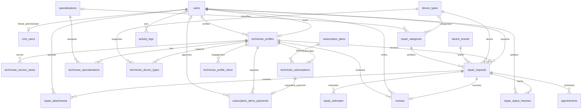

# eRepair database schema

The identity and operational tables use one PostgreSQL application database. Integration tests use the separate disposable `erepair_test` database. Statamic Core has one independent editor in `cms_users`, linked to the application administrator in `users`; customers and technicians stay in `users`. `repair_requests.serial_number` is encrypted by the Eloquent cast. The source of truth is `backend/database/migrations/`.

There are **38 tables and 14 migrations**, including the additive Premium plan
and scheduled-subscription state/index. The Premium migration adds no tables and
does not rewrite existing plans or purchase history. See the [complete column, constraint and index dictionary](database-data-dictionary.md) and [deployment instructions](database-deployment.md).

| Table | Main fields and constraints |
| --- | --- |
| users | bigint PK; unique email; name; hashed password; business role (customer/technician/admin); account status; Statamic super flag, preferences and auth metadata |
| cms_users | PK; unique user FK to the application administrator; unique email; independent password/auth metadata; unique singleton flag plus CHECK enforcing at most one actual CMS editor |
| cms_password_reset_tokens / cms_password_activation_tokens | Separate CMS authentication token namespaces; marketplace password tokens remain independent |
| technician_profiles | PK; unique user FK; biography; experience 0..60; verification status and reviewer FK; availability; city/province; optional public service-area coordinates and private photo path |
| device_types | PK; unique slug; name; active |
| device_brands | PK; unique slug; name; active |
| specializations | PK; unique slug; name; description; active |
| technician_specializations | technician profile FK + specialization FK; unique pair |
| technician_device_types | technician profile FK + device type FK; unique pair |
| technician_service_areas | PK; profile FK; city; province; unique profile/city/province; no coordinate columns |
| repair_categories | PK; optional device type/specialization FKs; unique slug; name; active |
| repair_requests | PK; unique reference; customer FK; technician profile FK; device type/brand/category FKs; model; encrypted optional serial; problem_description; status; completed_at; timestamps |
| repair_attachments | PK; request FK; uploader FK; private disk path; original_name; MIME; size; timestamps |
| repair_status_histories | PK; request FK; previous/new status; actor FK; remarks; timestamp; append-only |
| repair_estimates | PK; request FK; positive decimal(12,2) amount; PHP currency; description; pending/approved/rejected/superseded status; timestamps |
| appointments | PK; request FK; starts/ends at (timestamptz); service_location; proposed/confirmed/completed/canceled status; timestamps |
| reviews | PK; unique repair request FK; customer FK; technician FK; rating CHECK 1..5; body; hidden flag; composite FK matches the repair's customer and technician |
| notifications | UUID PK; Laravel notification type; polymorphic recipient; JSON data; read_at |
| activity_logs | PK; actor FK nullable; action; subject type/ID; sanitized JSON metadata; timestamp |
| role_user / group_user | Retained legacy permission/group pivots; native multi-user roles/groups are not used by the Core setup |
| subscription_plans | PK; unique slug; name; description; decimal(10,2) price; duration_days; JSON features; is_active; timestamps; Free price remains zero |
| technician_subscriptions | PK; technician_id and subscription_plan_id FKs; pending/active/scheduled/expired/cancelled status; starts_at/expires_at; active and scheduled periods require both dates with expiration after start |
| subscription_demo_payments | PK; technician_id FK; unique technician_subscription_id FK; decimal(10,2) amount; quoted plan_name/duration_days; unique transaction_reference; technician-scoped idempotency_key; method/status/demo flags; approved_by FK; approval/rejection dates; composite FK matches the subscription's technician |
| technician_profile_views | PK; technician_id FK; viewed_on; rotating visitor_hash; unique technician/day/hash; no raw IP/user ID |
| password_reset_tokens / password_activation_tokens | Marketplace email-keyed token namespaces, independent of CMS tokens |
| sessions | String PK; indexed nullable user_id; IP/user agent; encrypted payload; indexed last_activity; no SQL FK across independent guards |
| webauthn | Native string credential PK, string user_id, name, JSON credential, last_login and timestamps; no SQL user FK |
| cache / cache_locks | Keyed cache values and lock owners; indexed expiration |
| jobs / job_batches / failed_jobs | Database queue payloads, batch/job counters, lifecycle metadata and failures |
| migrations | Applied migration name, batch and ID |
| hosted_file_states | Smallint PK; epoch UUID; revision; timestamps |
| hosted_files | PK; root; path; unique root/path_hash; directory flag; size; checksum; encoded payload; timestamps |

Every FK has a valid nonpartial index beginning with its first referencing column. Existing owner/status indexes are reused; 19 new indexes support reverse pivots, lookup references, reviews and repair history. Composite ownership FKs reject mismatched reviews/payments even when individual IDs exist. Restrictive deletes preserve participants and reviewed repairs; owned child records retain their existing cascade policies.

Partial unique indexes prevent duplicate active/pending/scheduled subscriptions
and pending payments. Quote snapshots preserve historical pricing. Only approved
simulated payments count as simulated revenue; approval/rejection metadata must
match status. Paid access checks approval and exact start/expiration at request
time. Same-plan renewal preserves remaining time; cross-plan changes start after
the current paid period. No real gateway is integrated.

Database checks do not replace backend authorization, appointment conflict checks, completion-only reviews or latest-estimate approval. Monetary values use decimals and integer-centavo arithmetic. Domain timestamps use UTC storage and Asia/Manila presentation; native/framework authentication timestamps keep package-defined types.

Statamic pages, FAQs, announcements, repair services, globals and blueprints are files, not extra SQL content tables. The optional hosted mirror preserves files/uploads in the shared database. Base64 payloads are not inherently encrypted: protect database access/backups and retain the stable application key. Polymorphic notifications/activity references intentionally have no direct SQL target FK.

`php artisan erepair:database-check` checks constraint/index metadata read-only. The production check additionally covers deployment settings, PostgreSQL version, privileges and pending migrations. Hardening uses transactional DDL with a five-second lock timeout; invalid legacy data aborts the upgrade without automatic cleanup.

Use current patched PostgreSQL **16+** for production. The local **14.5** runtime is for demonstration only. PostgreSQL 14 reaches end of support November 12, 2026; see the [official versioning policy](https://www.postgresql.org/support/versioning/). Actual target-host TLS, patch level, recovery and capacity require separate acceptance.
