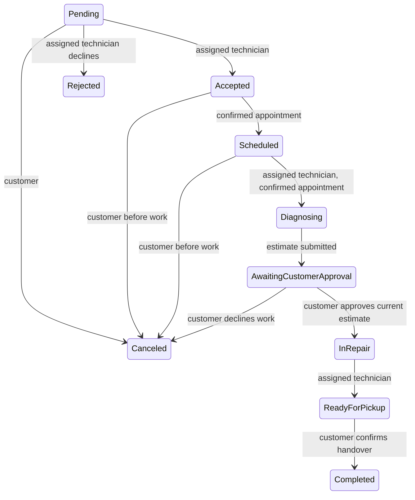

# Repair workflow

> Current scope: PWA installation was removed at the user's request. eRepair is a regular online web application. Older PWA results below are historical evidence, not current features or deployment requirements. See [web delivery](web-delivery.md).

Repairs begin with a customer selecting a suitable technician. The five-step request form, ownership policy, transactional services, history, private attachments, appointments, estimates, notifications, completion and reviews use the same Laravel/PostgreSQL backend. The backend and HTTP suites pass. A separate live Vue DOM/API test also passed discovery, login, photo request, technician acceptance, appointment confirmation, estimate approval, repair progress, completion and review with persisted history. Actual browser rendering remains a separate acceptance check; the application uses regular online web delivery.

Implemented state machine:

No arbitrary status PATCH is allowed. The service checks actor, request ownership, current status and prerequisites under a row lock. Record previous/new state, actor, UTC timestamp and remarks on every change. Completion is customer-confirmed; technician marks work ready. Canceled/rejected/completed states are terminal. Corrections require a separately audited administrator process, not editing history.

Five-step request form: device → problem/photos → technician → preferred appointment/location → confirmation. Generate a unique database-constrained reference server-side. Appointment times are entered/displayed in Asia/Manila and stored in UTC; check service availability, time range and overlapping confirmed appointments. Keep repair serial numbers and location details private.

Customer changes to an appointment require technician reconfirmation. A scheduled repair remains at that status while the change is proposed, but the transition to diagnosis is blocked until a confirmed appointment exists. This is verified through the actual API and PostgreSQL integration tests.

The Vue form imports `src/lib/repair-request.ts` for approved/available technician compatibility, category/device constraints, one-hour appointments interpreted in Philippine time, and photo selection limits. Its matching-technician step supports result pagination and rejects incompatible preselected profiles before advancing. Twenty-three standalone rule tests pass without npm downloads. Vue route/authentication tests and the real DOM/API repair journey pass; physical browser acceptance remains separate.

Store estimates as decimal PHP amounts with immutable revisions; approve only the current pending revision. Upload allowlisted image/document types with content validation, size limits, randomized paths on a private disk and policy-protected downloads. Reviews require a completed customer-owned repair and a unique repair FK. Database notifications accompany material actions; email delivery is optional later.
